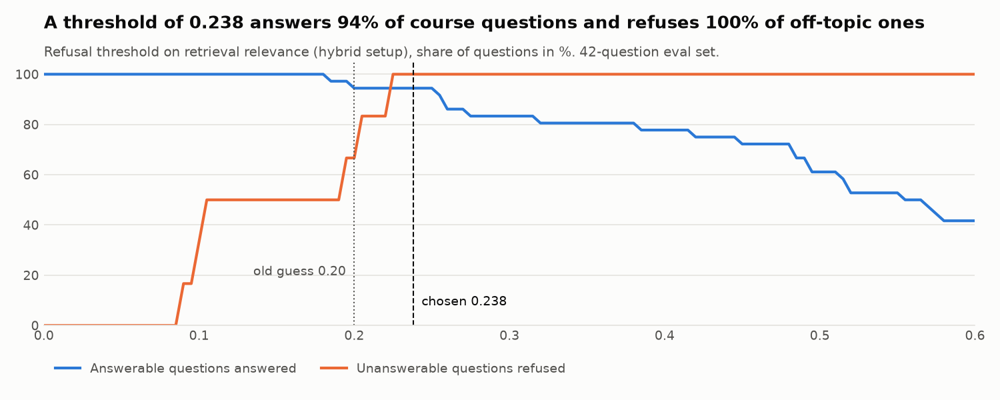
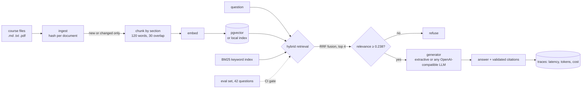
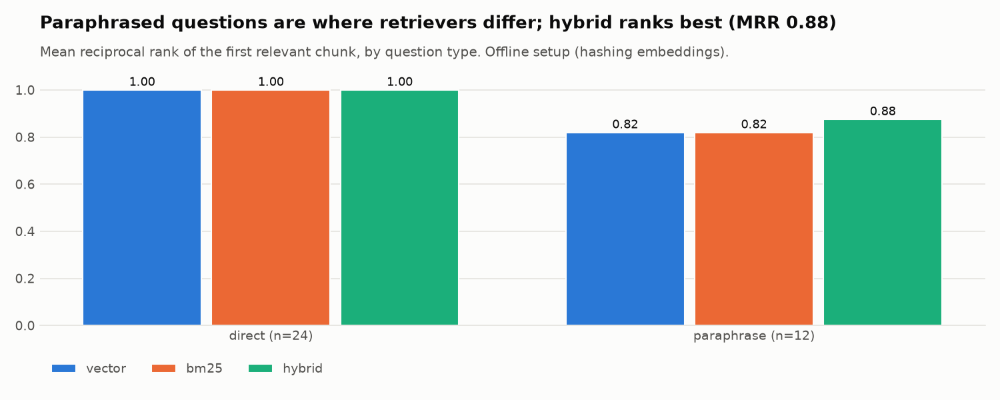

# Course RAG Assistant with Evals


A question-answering assistant over course material that **cites its sources, refuses when the
answer isn't in the material, and is measured on every commit**. The focus is the engineering
around the LLM: incremental indexing, hybrid retrieval, a data-chosen refusal threshold, an
evaluation set with a quality gate in CI, and latency and cost tracing.

**What this project shows**

- Retrieval built and measured: BM25 and vector search fused with Reciprocal Rank Fusion, scored
  by hit rate and MRR per question type.
- Decisions made from data: the refusal threshold comes from a sweep over the eval set (off-topic
  refusals 83% → 100% at the same answer rate).
- LLM features treated like software: citations validated, hallucinated sources detected, cost
  tracked, CI fails when quality drops, and everything runs offline for tests.



## Problem

Students ask the same questions about course material late at night. A chatbot that makes things up
is worse than none. This assistant answers only from the course notes, shows where each sentence
comes from, and says "I can't find this" when it should. Because quality is measured with a fixed
test set, every change (chunk size, retriever, model) is compared with numbers, not opinions.

## Architecture



Step-by-step explanation of the code: **[docs/how-it-works.md](docs/how-it-works.md)**.
Why each choice was made: **[docs/decisions.md](docs/decisions.md)**.

## Quick start

```bash
python -m venv .venv && source .venv/bin/activate
make install
make compare                         # index + evaluate vector vs BM25 vs hybrid
course-rag ask "How does a type 2 slowly changing dimension keep history?"
course-rag sweep --charts docs/img   # choose the refusal threshold from the eval set
course-rag serve                     # http://localhost:8000/docs

make up       # Docker: Postgres + pgvector + API
make up-llm   # Docker: same, answering with a local Llama model through Ollama
```

Example:

```
$ course-rag ask "How does a type 2 slowly changing dimension keep history?"
A type 2 slowly changing dimension keeps history by adding a new row with valid_from and valid_to
dates, so that facts can be joined to the attributes that were true at that time. [05-data-modelling#3]
...
```

Everything runs offline by default (hashing embeddings + extractive answers), so CI needs no API
keys. Switch to a neural embedder or a real LLM with environment variables (see `.env.example`).

## Results

42 questions: 24 that reuse words from the notes (*direct*), 12 *paraphrased* ones that don't, and
6 the notes can't answer. Offline setup, refusal threshold 0.238:

| Setup | Hit rate@4 | MRR | Answer rate | Correct refusals | Citations valid | Grounded | p50 latency |
| --- | --- | --- | --- | --- | --- | --- | --- |
| Vector only (hashing) | 0.97 | 0.94 | 0.89 | 1.00 | 1.00 | 1.00 | 0.7 ms |
| BM25 only | 0.97 | 0.94 | 0.94 | 0.83 | 1.00 | 0.97 | 0.2 ms |
| **Hybrid (RRF)** | **0.97** | **0.96** | **0.94** | **1.00** | 1.00 | 0.97 | 0.8 ms |



What the numbers say:

- All setups are perfect on *direct* questions; **paraphrases are where they differ**, and hybrid
  ranks best there (MRR 0.88 vs 0.82).
- The remaining misses are paraphrases with no shared words ("untouched copy of incoming files" →
  bronze layer). That is where a neural embedder should help: the next experiment.
- The swept threshold fixed the one false answer of the earlier setup ("Which Python web framework is
  fastest?", answered from the Airflow notes because "Python" matched). With only 6 off-topic
  questions, this needs confirming on a larger held-out set.
- Faithfulness is trivially 1.0 for the extractive generator, which copies sentences. It becomes a
  meaningful metric with an LLM. Cost is $0 offline; with an LLM, token prices in `.env` turn into
  cost per 1,000 questions in the report.

## Design decisions (summary)

- **Evaluation first:** eval set + thresholds in the repo; CI fails when quality drops.
- **Hybrid retrieval with RRF:** keywords for exact terms, vectors for meaning, no weight tuning.
- **Refuse below a data-chosen threshold** instead of guessing.
- **Citations are checked, not trusted.**
- **Incremental indexing** with content hashes; cascade deletes in Postgres.
- **Section-aware chunks** so a citation points to one topic.
- **Pluggable parts:** embedders, stores and generators behind small interfaces.

Full reasoning, costs and alternatives: [docs/decisions.md](docs/decisions.md).

## Project layout

```
src/course_rag/
  documents.py   loading (md, txt, pdf) and section-aware chunking
  embeddings.py  hashing / sentence-transformers / OpenAI-compatible
  store.py       MemoryStore and PgVectorStore
  bm25.py        BM25 written out in ~50 lines
  retrieval.py   vector + BM25 + RRF, relevance score
  ingest.py      incremental indexing
  answer.py      extractive and LLM generators, refusal, citations, cost
  evals.py       metrics, per-type breakdown, threshold sweep, CI gate
  charts.py      README charts
  tracing.py     SQLite trace log
  api.py, cli.py
corpus/          six short data engineering course notes (written for this project)
evals/           questions.yaml (42) and thresholds.yaml
docs/            how-it-works, decisions, charts
```

## Testing and quality

- **22 tests**: chunking and overlap, BM25 and RRF, incremental indexing (add, change, delete),
  citations and refusals, the LLM generator against a mocked API (prompt, cost, hallucinated
  citation detection), the threshold sweep, per-type metrics, the CLI end to end, the HTTP API, and
  the pgvector store against a real Postgres.
- **CI**: ruff, mypy, pytest with a pgvector service and an 80% coverage gate, then the eval gate,
  with the eval report uploaded as a build artifact.
- `pre-commit install` runs the same checks locally.

## What I'd do next

- Compare with a multilingual sentence-transformers model; add Vietnamese and Finnish questions.
- A held-out question set for choosing the threshold, separate from the reported results.
- Cross-encoder re-ranking for a sharper relevance score.
- LLM-as-judge for answer quality, checked against a small set of human labels.
